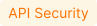

[apid-overview]:                overview.md
[apid-risk-score]:              risk-score.md
[apid-track-changes]:           track-changes.md
[apid-rogue]:                   rogue-api.md
[check-attack]:                 ../user-guides/events/check-attack.md
[di-apis]:                      ../images/about-wallarm-waf/api-discovery-2.0/discovered-inventory-apis.png
[di-mcp]:                       ../images/about-wallarm-waf/api-discovery-2.0/discovered-inventory-mcp.png
[di-attention]:                 ../images/about-wallarm-waf/api-discovery-2.0/discovered-inventory-apis-attention.png

# Discovered Inventory Dashboard 

--8<-- "../include/api-discovery/dashboard.md"